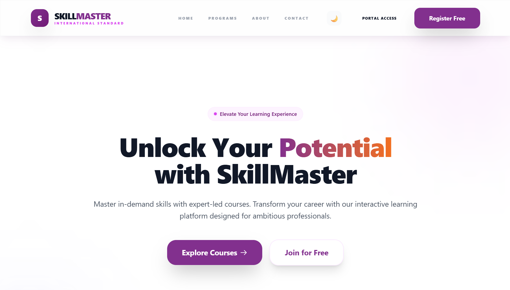
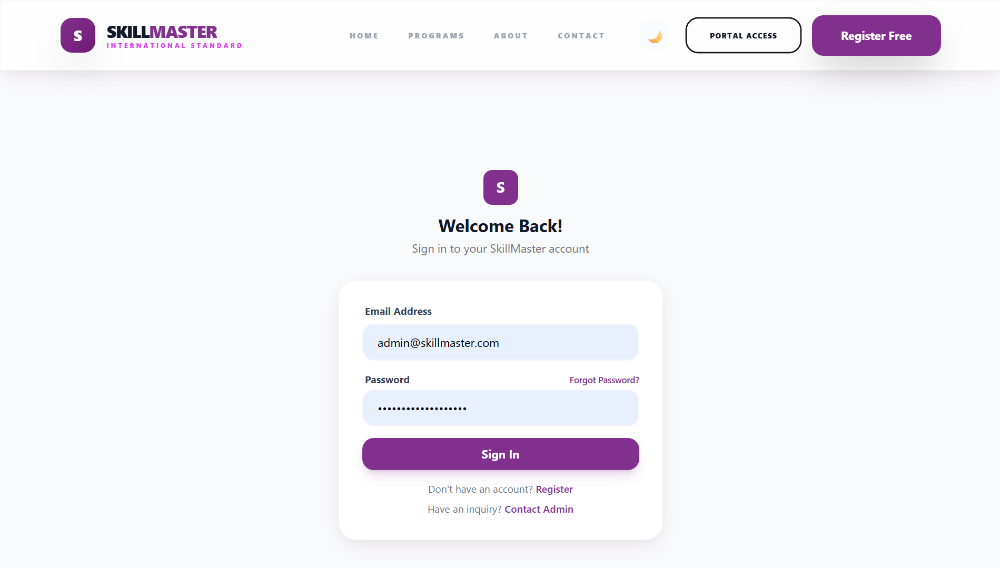
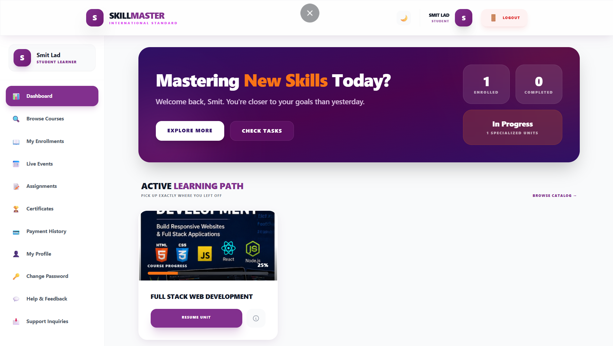
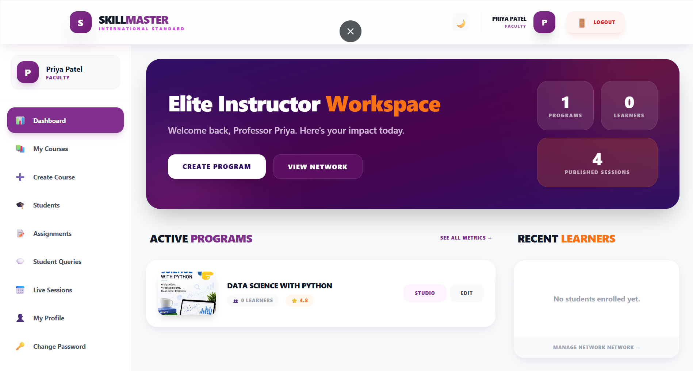
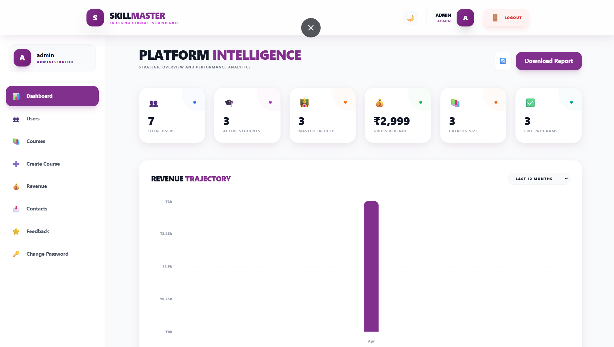
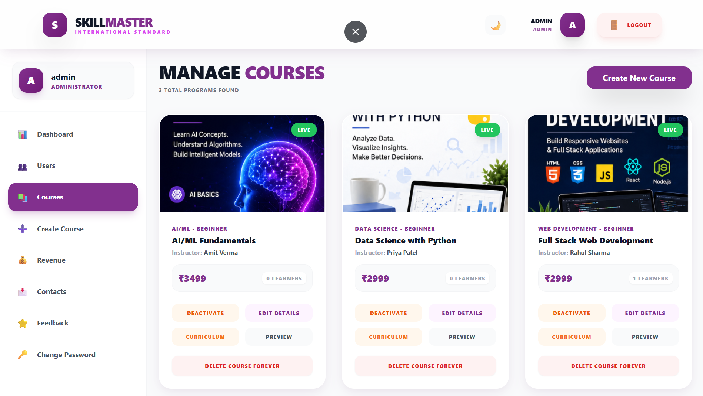

# GyaanLMS

GyaanLMS is a full-stack learning management system for students, faculty, and administrators. It supports course delivery, progress tracking, assignments, feedback, and course administration.

## Features

### Students

- Browse courses, enroll, and watch video lectures.
- Enroll directly through the application; no external payment gateway is integrated.
- Read Markdown-formatted lecture descriptions.
- Track lesson and course completion.
- View and submit assignments, ask course questions, and join live sessions.
- Generate a certificate PDF in the browser after course completion. Selecting **View Certificate** opens it in a new tab; use the PDF viewer's download control to save it.
- Manage profile, feedback, and payment history.

### Faculty

- Create and manage courses, lectures, and Markdown lecture descriptions.
- Manage assignments, student queries, and live sessions.
- Review student and course progress.

### Administrators

- Manage users and courses.
- Review platform activity, revenue, contacts, and feedback.

### Shared experience

- Responsive student, faculty, and admin layouts.
- Role-based access control and JWT authentication.
- Dark mode.
- Cloudinary integration for uploaded media.

## Technology

- **Frontend:** React, Vite, Tailwind CSS, Redux Toolkit, React Router
- **Backend:** Node.js, Express, MongoDB, Mongoose
- **Services:** Cloudinary for media; SMTP/Nodemailer for email

## Project structure

```text
GyaanLMS/
|-- backend/
|   |-- config/
|   |-- controllers/
|   |-- middleware/
|   |-- models/
|   |-- routes/
|   |-- utils/
|   `-- server.js
|-- frontend/
|   |-- src/
|   |   |-- components/
|   |   |-- layouts/
|   |   |-- pages/
|   |   |-- redux/
|   |   |-- services/
|   |   `-- utils/
|   `-- vite.config.js
`-- screenshots/
```

## Local development

### Requirements

- Node.js 18 or later
- MongoDB connection string (local MongoDB or MongoDB Atlas)

### 1. Configure the backend

Create `backend/.env` with the required values:

```env
PORT=5000
MONGO_URI=<your-mongodb-connection-string>
JWT_SECRET=<a-long-random-secret>
CLIENT_URL=http://localhost:5173
```

Email and Cloudinary settings are needed for their related features. See [backend/README.md](./backend/README.md) for all environment variables.

Then run:

```bash
cd backend
npm install
npm run dev
```

The API listens on `http://localhost:5000`.

### 2. Configure and run the frontend

Create `frontend/.env`:

```env
VITE_API_URL=/api
```

The Vite development server proxies `/api` and `/uploads` to the backend at `http://localhost:5000`.

In a second terminal:

```bash
cd frontend
npm install
npm run dev
```

Open `http://localhost:5173`.

To create demo data, run `npm run seed` from `backend` only against a disposable development database. The seed script deletes existing users and courses in the configured database before inserting demo records.

## Screenshots

| Page | Screenshot |
|---|---|
| Home |  |
| Login |  |
| Student dashboard |  |
| Faculty dashboard |  |
| Admin dashboard |  |
| Course details |  |

## Build

Build the frontend production bundle from the `frontend` directory:

```bash
npm run build
```

Before deploying, configure production environment variables and update the backend CORS allowlist for the deployed frontend origin.

## Links

- Live application: [GyaanLMS on vercel](-)
- Source repository: [Smitlad-11/GyaanLMS](https://github.com/shubhamrdg/GyaanLMS)

## Author

**Shubham Gupta**  
BTech Student | MERN Stack Developer
